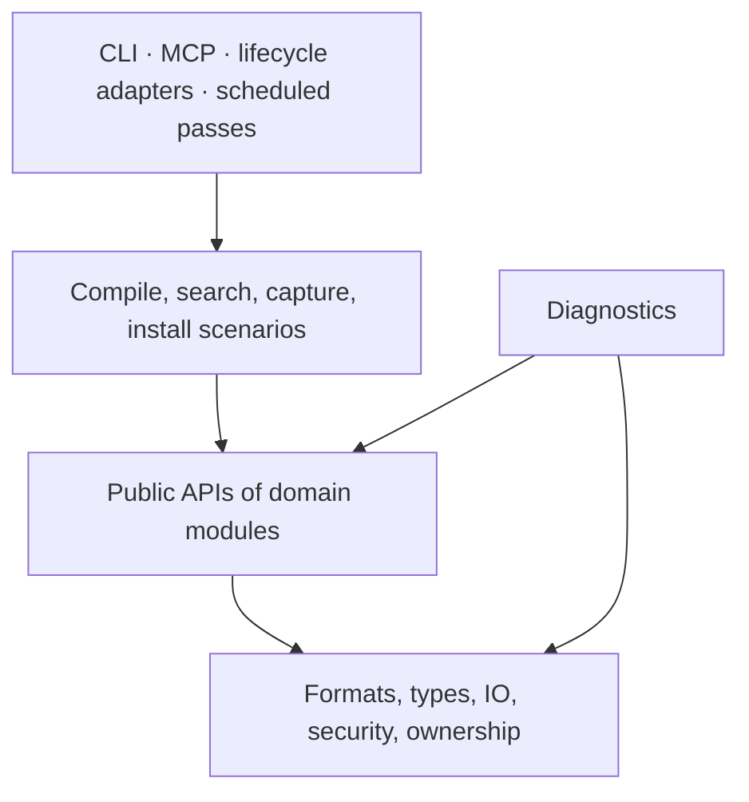

# Proposal: isolated LLM Wiki modules of up to 100,000 tokens

Research date: 2026-11-02. Status: **a draft for approval, not an accepted architecture**.
The working session of that branch records that the user allowed the research and the
preparation of a scheme. No sources were
moved, no paths were changed and nothing was installed. This research does not
lift the pause of the earlier task under item 7.

**Clarification after checking laws 4, 6 and 7:** the number 74 and the table below
remain initial hypotheses, not a target structure recommended for approval.
A mass move by this table is not justified. The current results, the comparison
of options and the refined pilot are in
[the check of boundaries and real spending](2026-11-02-module-boundaries-validation.md).
It replaces the proposal to approve the whole layout and to start with file security.

## Proposed solution

Keep one product, repository, installation and the existing runtime contracts.
Inside it, extract Python packages with explicit interfaces, one-way
dependencies and owners of mutable state. The preliminary map below
contains 33 areas and 74 candidate program modules. An area is a navigation
group, not a module with its own limit. Boundaries are defined by responsibility;
74 is the result of this version of the draft, not a quota and not a requirement to create empty packages.

Each final module must pass the limit together with its tests, instructions,
schemas, fixtures, documentation and the necessary dependency contracts.
Existing sizes are measured; the sizes of modules not yet extracted are **not measured**.
This scheme does not prove that all 74 already fit under the ceiling. Shared tests,
benchmarks and documentation need their own topical packages and full accounting.
Approval of the scheme allows step-by-step extraction and checking, not declaring
the whole project compliant with the limit in advance.

## What is established on disk

Base of the installed tree: `e95f6a4a`; base of the unfinished working branch:
`3e1def7e`, `fix/compile-durable-progress-20261019`. Both trees were clean
before the research. Between them there are 135 changed files, 28 877 added and 847
removed lines. Designing only from the installed version would be a mistake:
the working branch already has the compile progress controller and journal.

Counting: `tiktoken==0.14.0`, `o200k_base`, `encode_ordinary`, UTF-8,
each Git-tracked file whole, including comments. For these trees there were
no binary exclusions in the source measurement. The numbers are the sum of file counts,
without future package separators and chat messages. This is not the cost of an API request
and not a confirmed tokenizer of a specific provider.

| Scope | Installed tree | Working branch |
|---|---:|---:|
| All tracked files | 7 789 705 | 8 075 520 |
| `scripts/` | 1 856 210 | 1 925 057 |
| `tests/` | 2 310 597 | 2 440 164 |
| `docs/` | 1 737 929 | 1 824 380 |
| `benchmark/` | 1 430 515 | 1 430 515 |

In the working branch, `scripts/` and `tests/` alone arithmetically need at least
44 packages of 100,000 tokens, still without repeated instructions and contracts.
All tracked files need at least 81 packages with non-overlapping coverage,
if their text is kept. These lower bounds are not an architecture.
Private knowledge and runtime are separate product data, not a free part of a
program module. If they enter a specific request, their tokens are counted.

| Large source file of the working branch | Tokens without tests |
|---|---:|
| `memory_queue.py` | 137 223 |
| `doctor.py` | 90 374 |
| `markdown_transaction.py` | 86 393 |
| `compile_memory.py` | 82 107 |
| `lsp_process.py` | 55 639 |
| `mcp_server.py` | 53 799 |
| `pyright_session.py` | 50 917 |

`test_lsp_process.py` alone takes 84 881 tokens; the test JSON
`compile-receipt-v3-foreign-body.json` takes 94 311. Moving tests into a shared folder
does not solve the overflow. Such a fixture either stays a separately counted
test artifact, or is reproduced by a generator with a check of the exact bytes
and with the purpose of the test preserved; generating it differently only for the limit is forbidden.

An exact search for identical files found only the mandatory pair `AGENTS.md` /
`CLAUDE.md` of 7 229 tokens each. It must not be deleted: the contract requires both copies.
There is no proven large reserve from deleting identical files. Semantic
duplication was not checked by this measurement. `docs/research/` takes
1 205 316 tokens: topical access to the history is useful, not its deletion.

## Dependency research and its limits

The first MCP `get_architecture` ended in a timeout. The changes check
reported `repository_index_unreadable`: there was no readable manifest.
The standard `repository_index.py index` re-indexed the working branch:
1 607 sources, 6 972 chunks, 38 371 symbols, 215.43 seconds;
`generation-18e438e866f3c6a3-87d68ff4`. The active memory index was not switched.
A repeated `get_architecture(mode=changes)` confirmed `stale=false`, zero
added, removed and changed sources in the covered roots
`scripts`, `tests`, `benchmark`. Documents and shell installers were checked
separately: they are not in these roots.

The overview through MCP kept running into workers that were busy earlier. The same built-in
function `code_graph.get_architecture` in a separate short-lived process read
the new generation. The graph has 111 entry points; among the most used components are
`reliable_memory` (234 importing modules), `markdown_transaction` (207),
`compile_memory` (184), `memory_queue` (139). Tests and benchmarks are counted here.
The graph states directly that link resolution is incomplete; it does not prove the absence
of dynamic calls or that code can be deleted.

An additional AST analysis of explicit imports was done without executing the sources.
It found 902 links and one strongly connected group of 91 Python files.
It includes imports inside functions and branches, including platform and
`TYPE_CHECKING` ones, so its cycles mean structural coupling, not
necessarily an import error at startup. Dynamic imports, subprocess,
string paths, configuration references and monkeypatch need separate checks.

Links confirmed from the sources that must be fixed by meaning:

- `reliable_memory` borrows file ACL checks from `memory_queue` and
  `markdown_transaction`. Basic file security rules must have
  their own owner and must not import the queue or publication.
- `operational_ownership` imports `markdown_transaction`; this prevents
  getting a lower ownership layer that publication depends on. The admission
  contract and registry storage must be separated from Markdown operations,
  keeping the one existing fence of the writer and the database.
- `doctor` reads private parsing functions of receipts and daily logs from
  `compile_memory`. It needs public read-only format readers, not the
  internals of the compile executor.
- `scheduled_nightly` imports generation maintenance from `doctor`.
  Diagnostics and maintenance execution must call a dedicated maintenance
  operation; the reporter must not be its owner.
- `tests/conftest.py` and `pyproject.toml` add `scripts` to `sys.path`.
  A move needs a module identity check: one implementation must not be
  loaded at the same time under the old and the new name, giving two states.

## What the limit means

Two measurements are proposed, without substituting one for the other:

1. **Ownership size:** the full source text of the module, its tests, fixtures,
   schemas, local documentation and instructions. Every file has an owner;
   a large file is split by responsibility, not excluded from the count.
2. **Work package:** the unique content of the first item plus the mandatory
   instructions and the public dependency contracts that are really needed. Wrappers
   and serialization separators are also counted. The 100,000 ceiling applies to both.

`AGENTS.md` and the nine laws currently take 9 815 tokens in total. With one
copy of identical rules, no more than 90 185 remain for the rest, before dependency
contracts. If the client actually sends both copies, both are counted.
No additional arbitrary ceiling of 60/80 thousand or a number of imports is introduced.
The margin is defined by the measured mandatory environment of each module.

Transitive dependency code is not counted as the consumer's property, but when
it is actually loaded it must enter the task's spending. A cross-module task
may need more than one package; this is shown explicitly, not cut off.
Schemas and shared fixtures have an owner, and their loaded bytes are counted for
each consumer. A plain reference instead of the needed context does not count as
successful compression.

All tracked files must have a classification: program module,
cross-module scenario, measurement tool, historical document, installation
contract or test data. An unbounded `common`, `tests`
or `misc` must not be left while the project is declared compliant. The completeness check compares
the ownership manifest with `git ls-files`, not only with files already assigned.

## Architecture and interfaces

Proposed paths after approval:

```text
scripts/llm_wiki/<area>/<module>/
    __init__.py     # only the declared public interface
    api.py          # contract types and operations, if needed separately
    ...            # internal implementation
tests/modules/<area>/<module>/
tests/scenarios/<scenario>/
docs/modules/<area>/<module>.md
```

These are new paths inside the existing allowed zones, not a new runtime root.
One distribution and one lockfile. There is no confirmed need now to extract separate
distributions, services or a universal event bus.
The current documented CLI files in `scripts/` keep their names as
thin entry points. They do not copy business logic. The module names below are draft names,
not stable external APIs declared today.

Dependency direction:



Scenario assembly links modules with explicit arguments and small Protocols where
alternative executors are really needed. No universal
dependency container. Neighbours' internal APIs are closed by import contracts.
Type checks do not replace runtime validation of untrusted data.

| Contract | Sole owner | Consumers and the invariant kept |
|---|---|---|
| `OwnerLease`, admission, deadline | ownership | All writers; the same shared fencing, an unknown owner is not considered dead |
| Queue enqueue/claim/heartbeat/settle | queue | Adapters and workers; payload hash, at-least-once, immutable results |
| Verified source stream + provenance | compile.sources | Planner, archive, receipt reader; exact bytes, logical path, digest and range |
| Validated plan + publication receipt | compile.validation/publication | CLI/MCP/nightly; do not present queueing as publication |
| Protected request/result | models.gateway/policy | Semantic scenarios; shared fail-closed DLP |
| Durable call outcome | compile.call_recovery/progress | Controller; an unknown outcome does not mean a repeat call is allowed |
| Prepare/apply/recover/undo | transactions | All Markdown writers; CAS, hashes and recoverability |
| Generation reader/publisher | generations | Search/code/maintenance; immutable generation and one pointer |
| Navigation request/result | code_navigation | MCP; deadline, readiness, containment and explicit incompleteness |
| Health finding + coverage | health | MCP/CLI/nightly; read-only observation is not a deletion permit |

Stored data formats and SQLite owners stay the same. Reorganizing
the code does not by itself allow database migration, recreating `run/`, deleting journals
or losing backup/restore compatibility. Importing JSON schemas and resource paths must
work from the CLI, from MCP and in the installed copy.

## Candidate map

The following table was added from the full list of Python files of the working branch.
"Code + unambiguous tests" is a lower estimate of today's area, not a size forecast
for each future module. The test binding rule: a matching source name or
the single explicit import from `scripts` found. Ambiguous tests are not
considered superfluous and are listed separately in the local measurements.

| Area | Code + unambiguous tests, tokens | Proposed modules |
|---|---:|---|
| foundation | 135 640 | `configuration`, `byte_io`, `sqlite`, `filesystem_security` |
| ownership | 26 314 | `ownership` |
| transactions | 117 915 | `publication`, `images`, `recovery` |
| queue | 177 606 | `store`, `delivery`, `results`, `operator`, `migration` |
| capture | 40 866 | `ingress`, `evidence` |
| breadcrumbs | 21 096 | `breadcrumbs` |
| compile | 191 922 | `sources`, `planning`, `validation`, `publication`, `progress`, `call_recovery` |
| claims | 74 175 | `ledger`, `derivation` |
| pages | 32 929 | `pages` |
| archives | 30 452 | `archives` |
| models | 78 509 | `gateway`, `policy` |
| generations | 177 144 | `corpus`, `catalog`, `graph` |
| search | 202 916 | `retrieval`, `resolver`, `answers`, `telemetry` |
| embeddings | 15 162 | `embeddings` |
| context | 57 892 | `context` |
| learning | 50 919 | `learning` |
| projects | 80 646 | `journal`, `blackboard` |
| code_parse | 49 292 | `code_parse` |
| code_graph | 90 055 | `graph`, `impact` |
| code_navigation | 85 170 | `facade`, `symbols` |
| repositories | 115 984 | `index`, `revision`, `retention` |
| lsp_protocol | 122 089 | `protocol`, `security` |
| lsp_process | 167 430 | `launch`, `containment`, `cleanup` |
| lsp_sessions | 171 718 | `documents`, `lifecycle`, `profiles` |
| mcp | 124 012 | `tools`, `transport`, `supervisor` |
| adapters | 87 480 | `lifecycle`, `codex` |
| install | 131 174 | `transactions`, `configuration`, `release` |
| tool_install | 68 196 | `languages`, `models` |
| health | 143 319 | `operational`, `history`, `maintenance` |
| maintenance | 47 670 | `maintenance` |
| recovery | 74 024 | `backup`, `repair` |
| traces | 12 641 | `traces` |
| quality | 16 449 | `quality` |

Ambiguous automatic binding: 728 test files, 1,173,552 tokens. These tests are not included in the lower estimates of the table.

The non-Python assets `scripts/queries`, `scripts/schemas` and the JS/PowerShell adapters
get owners code_parse, the format module and adapters/install respectively.
They are part of the final limit; the lower estimate of the table does not hide them as a proven
size of a future package. Tests with several dependencies are assigned by the scenario
they check, not automatically by the largest imported file.

Scenarios need separate packages: capture→terminal, compile→publication,
compile→recovery, queue→ownership, transaction→recovery, backup→restore,
install→upgrade, retrieval→answer, code→navigation, LSP→platform containment,
nightly→completion, MCP→lifecycle. These are initial boundaries; each package is also
measured. A large scenario is split by distinct guarantees, not by the alphabet of tests.
Benchmarks are split into the existing retrieval, code navigation, recovery,
compilation and answer-cost tasks; historical reports stay reachable through the index.

## First concrete cuts

**Queue.** `store` owns SQL and the job format, `delivery` owns leases and
execution transitions, `results` owns confirmed results, `operator` owns
inspect/cancel/redrive/corrupt-evidence operations, `migration` owns version
compatibility. Writing a result and finishing a lease keep the current atomicity:
several modules do not mean several independent transactions.

**Compilation.** `sources` collects verified streams, `planning` selects whole
units and context, `validation` checks the plan and the evidence, `publication`
ties the CAS write to the receipt, `progress` stores the steps, `call_recovery` manages
the external call and the uncertain outcome. The durable dry-run keeps the status its own
decision gave it; this draft does not declare its implementation finished.

**Markdown transactions.** `images` owns the format of before/after images,
`publication` owns prepare/CAS/apply, `recovery` owns recovery/undo/retention.
The SQLite owner and the shared admission stay single. Do not replace
the coordinator with many competing writers.

**LSP.** Separate the protocol and security, launch and containment, documents,
lifecycle and profiles. Windows Job Object, the POSIX group, the heartbeat and cleanup
must have one lifecycle owner; an isolated package is not an OS sandbox.

**Doctor.** Operational readers, historical readers and generation maintenance
are separated by different authorities. The nightly run calls maintenance directly,
and health collects the results through a public contract.

## Why this option

Three independent groups of primary sources were researched as of 2026-11-02:

- [Martin Fowler: Bounded Context](https://martinfowler.com/bliki/BoundedContext.html)
  and [Strangler Fig](https://martinfowler.com/bliki/StranglerFigApplication.html):
  domain boundaries and gradual replacement. These are stable principles from older
  publications, not new measurement results of this project. Here they justify
  explicit module relations and moving in small finished steps.
- [Import Linter: contracts](https://import-linter.readthedocs.io/en/stable/contract_types/),
  [protected](https://import-linter.readthedocs.io/en/stable/contract_types/protected/),
  [acyclic siblings](https://import-linter.readthedocs.io/en/stable/contract_types/acyclic_siblings/)
  and [release notes](https://import-linter.readthedocs.io/en/stable/release_notes/).
  The documentation lists 2.15 of 2026-09-04; a candidate for a dev-only check.
  It provides checkable import boundaries, but does not control subprocess,
  data or runtime permissions. Compatibility of the specific dependency set must
  pass the resolver and the existing CI matrix before it is added to the lockfile.
- [Python PEP 544](https://peps.python.org/pep-0544/) and
  [typing for Python 3.10](https://docs.python.org/3.10/library/typing.html):
  Protocol is available in the syntax the project supports and allows defining
  narrow contracts without a new runtime framework. Annotations do not check
  values at run time by themselves. [The mock patching rules](https://docs.python.org/3.10/library/unittest.mock.html#where-to-patch)
  matter for moving tests: a patch must stay in the consumer's namespace.

The Python documentation marks 3.10 as a version no longer supported upstream.
The current repository contract is still `>=3.10`; it must not be changed on one's own
within the decomposition. Revising support is a separate decision with a check of consumers.

| Alternative | Conclusion for this project |
|---|---|
| Only short summaries and context selection | Useful immediately, but cycles and internal imports will remain |
| Splitting files by 100k without regard to meaning | Rejected: the size is met at the cost of cross-module coupling |
| Isolated packages inside one installation | Recommended: checkable boundaries while keeping transactions and operations |
| Separate repositories/distributions | Now complicate versions, installation and atomic changes; the need is not proven |
| Microservices/daemon/message bus | Add network failures and contradict the current product constraints |
| Minification/deleting history/weakening tests | Do not keep the needed properties, so they are not safe compression |

## Migration and rollback

1. Approve this draft and the exact meaning of the limit. Then write a decision page,
   update `docs/STRUCTURE.md`, `AGENTS.md`/`CLAUDE.md` consistently and the structural
   tests. Before this step, do not create the target implementation structure.
2. Record full file ownership, sizes and pairs of real tasks for
   comparison. Add package measurement and import checks. Show existing violations
   explicitly; baseline exceptions must not be presented as a finished final gate.
3. The initial candidate (revised in the research above) is byte IO and file security: remove the reverse borrowings
   of ACL, keeping bytes, errors, deadlines and POSIX/Windows behaviour. If the analysis shows
   that the extraction breaks atomicity, correct the draft before the move.
4. Extract read-only contracts of sources/receipts and health readers. Then the queue,
   the transaction API and compilation. First reconcile the changes of the unfinished item 7
   with the working branch; do not install it whole only for the new structure.
5. Move the remaining areas bottom-up; CLI/MCP/install adapters after
   the contracts. At each step check imports, resources, mocks, installation,
   context cost and rollback. A mechanical move must not be mixed with
   a change of formats or behaviour in one uncheckable operation.
6. After qualification, perform a supported installation with verified preimages,
   maintenance fence and restart of the owners by the standard path. Keep the old
   code and lockfile for rollback; perform backup/restore in a separate staging root
   before changing the live installation. A direct `git reset` of the running vault is not
   a recovery procedure.
7. Delete the replaced implementation after checking all consumers. A stable
   CLI wrapper is a supported entry point, not a temporary duplicate. Temporary import
   adapters have a list of consumers and a removal condition: all are migrated,
   search and integration checks find no references. Do not leave double
   implementations or indefinite exceptions in the checks.

Each move is admitted to installation after the related regressions, lizard CCN≤5
for each changed function, the nesting limit check, ruff, the contract
check, the token gate and CI on the supported platforms. Before finishing
the structure change: full pytest and the checks from `docs/STRUCTURE.md`.
READMEs change in sync in EN/RU/ZH if user commands change;
a release/version bump needs consistent CHANGELOG and pyproject by the contract.

## Checking safety and usefulness

Mandatory scenarios: lease loss; a crash between SQL/file actions;
an unknown model call outcome; repeated delivery; DLP refusal; a source change
between reading and publication; undo; Restic restore; cold/warm MCP startup;
Windows/POSIX LSP cleanup; installation and rollback with private data preserved.
The result is a comparison of semantics, exact sources and evidence, not only
green module tests. Do not run a paid repeat execution of historical
work to demonstrate the structure.

Pairs of real tasks are taken from compilation, search, capture, LSP, installation and
recovery. On the same input data and model, quality,
all input/output/cache tokens, repeated calls, time, peak RSS and operator
intervention are recorded. The number of runs is set by the spread of measurements and scenario coverage,
not by an arbitrary quota. No savings percentage is promised in advance. Code deletion,
package size, actual context and full task spending are different metrics.

## Limits of current readiness

The operational doctor of 2026-11-02 ended with `error`: nightly/weekly failed;
there are accumulated capture losses and LSP cleanup limits. Full historical
integrity and backup restore were not examined by this check. MCP processes
are running. This allows preparing the draft, but does not allow calling the live
installation ready for a mass migration. Nobody's processes were stopped,
`run/` was not cleaned, compilation/switching to the unfinished branch were not started.

The distribution of tests/fixtures/docs must be brought to a full manifest, and
the real extracted packages measured. Today there is a map of all Python sources, not
proof of isolation of each future module. Links the graph did not resolve and
multi-component tests stay an explicit part of the work for each move.

## Local evidence

Full file sizes, SHA-256, conservative imports, the results of the built-in
indexing, the graph and the operational doctor are saved in the gitignored
`logs/modularity-2026-11-02-*`. The full list of sources by area is there as well.
These data reflect the named commits before this report was added. Opening
the document does not mean that all local evidence is published.
A repeated measurement must read `git ls-files -z`, count each file with the same
tokenizer and compare SHA-256; after the file set changes, the result is new.
