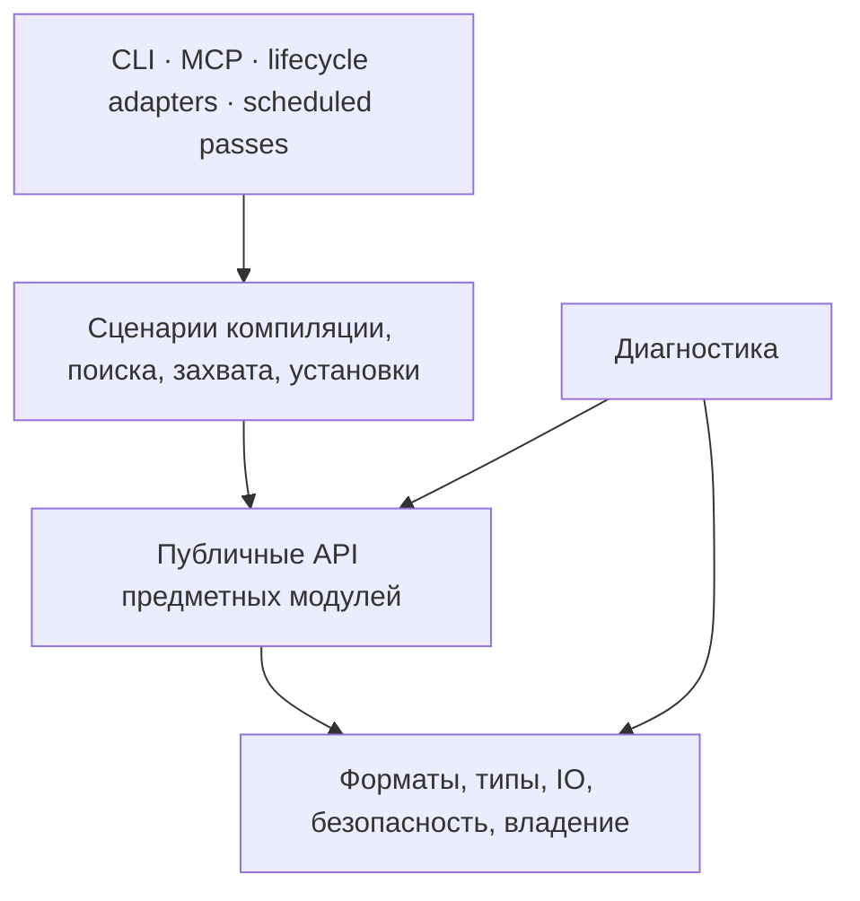

# Предложение: изолированные модули LLM Wiki до 100 000 токенов

Дата исследования: 2026-11-02. Статус: **проект для согласования, не принятая архитектура**.
Пользователь разрешил исследование и подготовку схемы. Перенос исходников,
изменение путей и установка не выполнялись. Пауза прежней задачи по пункту 7
не отменена этим исследованием.

**Уточнение после проверки законов 4, 6 и 7:** число 74 и таблица ниже остаются
первоначальными гипотезами, а не рекомендуемой к утверждению целевой структурой.
Массовый перенос по этой таблице не обоснован. Актуальные результаты, сравнение
вариантов и уточнённый пилот находятся в
[проверке границ и реального расхода](2026-11-02-module-boundaries-validation.md).
Она заменяет предложение утвердить всю раскладку и начать с файловой безопасности.

## Предлагаемое решение

Сохранить один продукт, репозиторий, установку и существующие runtime-контракты.
Выделить внутри него Python-пакеты с явными интерфейсами, однонаправленными
зависимостями и владельцами изменяемого состояния. Предварительная карта ниже
содержит 33 области и 74 кандидата в программные модули. Область — навигационная
группа, а не модуль с отдельным лимитом. Границы определены ответственностью;
74 — результат этой версии проекта, не квота и не требование создавать пустые пакеты.

Каждый конечный модуль должен проходить лимит вместе с тестами, инструкциями,
схемами, фикстурами, документацией и необходимыми контрактами зависимостей.
Существующие размеры измерены; размеры ещё не выделенных модулей **не измерены**.
Эта схема не доказывает, что все 74 уже укладываются в потолок. Совместные тесты,
бенчмарки и документация требуют собственных тематических пакетов и полного учёта.
Согласование схемы разрешает последовательное выделение и проверку, а не объявление
всего проекта соответствующим лимиту заранее.

## Что установлено на диске

База установленного дерева: `e95f6a4a`; база незавершённой рабочей ветки:
`3e1def7e`, `fix/compile-durable-progress-20261019`. Оба дерева были чистыми
до исследования. Между ними 135 изменённых файлов, 28 877 добавленных и 847
удалённых строк. Проектировать только по установленной версии было бы ошибкой:
в рабочей ветке уже появились контроллер и журнал прогресса компиляции.

Подсчёт: `tiktoken==0.14.0`, `o200k_base`, `encode_ordinary`, UTF-8,
каждый отслеживаемый Git файл целиком, включая комментарии. Для этих деревьев
бинарных исключений в исходном измерении не было. Числа — сумма подсчётов файлов,
без будущих разделителей пакета и сообщений чата. Это не стоимость API-запроса
и не подтверждённый токенизатор конкретного провайдера.

| Состав | Установленное дерево | Рабочая ветка |
|---|---:|---:|
| Все отслеживаемые файлы | 7 789 705 | 8 075 520 |
| `scripts/` | 1 856 210 | 1 925 057 |
| `tests/` | 2 310 597 | 2 440 164 |
| `docs/` | 1 737 929 | 1 824 380 |
| `benchmark/` | 1 430 515 | 1 430 515 |

В рабочей ветке только `scripts/` и `tests/` требуют арифметически не менее
44 пакетов по 100 000 токенов, ещё без повторяемых инструкций и контрактов.
Все отслеживаемые файлы — не менее 81 пакета при непересекающемся покрытии,
если их текст сохраняется. Эти нижние границы не являются архитектурой.
Приватные знания и runtime — отдельные данные продукта, а не бесплатная часть
программного модуля. Если они входят в конкретный запрос, их токены считаются.

| Крупный исходник рабочей ветки | Токены без тестов |
|---|---:|
| `memory_queue.py` | 137 223 |
| `doctor.py` | 90 374 |
| `markdown_transaction.py` | 86 393 |
| `compile_memory.py` | 82 107 |
| `lsp_process.py` | 55 639 |
| `mcp_server.py` | 53 799 |
| `pyright_session.py` | 50 917 |

`test_lsp_process.py` сам занимает 84 881 токен; тестовый JSON
`compile-receipt-v3-foreign-body.json` — 94 311. Перенос тестов в общую папку
не решает переполнение. Такой fixture либо остаётся отдельно учитываемым
тестовым артефактом, либо воспроизводится генератором с проверкой точных байтов
и сохранением назначения теста; генерировать его иначе лишь ради лимита нельзя.

Точный поиск одинаковых файлов дал только обязательную пару `AGENTS.md` /
`CLAUDE.md` по 7 229 токенов. Удалять её нельзя: контракт требует обе копии.
Доказанного большого резерва удаления идентичных файлов нет. Семантическое
дублирование этим измерением не проверялось. `docs/research/` занимает
1 205 316 токенов: полезен тематический доступ к истории, а не её удаление.

## Исследование зависимостей и его пределы

Первый MCP `get_architecture` завершился по таймауту. Проверка изменений
сообщила `repository_index_unreadable`: отсутствовал читаемый манифест.
Штатный `repository_index.py index` заново проиндексировал рабочую ветку:
1 607 исходников, 6 972 chunks, 38 371 символ, 215,43 секунды;
`generation-18e438e866f3c6a3-87d68ff4`. Активный индекс памяти не переключался.
Повторный `get_architecture(mode=changes)` подтвердил `stale=false`, ноль
добавленных, удалённых и изменённых исходников в покрытых корнях
`scripts`, `tests`, `benchmark`. Документы и shell-инсталляторы проверялись
отдельно: они не входят в эти корни.

Обзор через MCP продолжал упираться в занятые ранее работники. Та же встроенная
функция `code_graph.get_architecture` в отдельном краткоживущем процессе прочитала
новую генерацию. В графе 111 точек входа; среди наиболее используемых компонентов
`reliable_memory` (234 импортирующих модуля), `markdown_transaction` (207),
`compile_memory` (184), `memory_queue` (139). Здесь учтены тесты и бенчмарки.
Граф прямо сообщает неполноту разрешения связей; он не доказывает отсутствие
динамических вызовов или возможность удаления кода.

Дополнительный AST-анализ явных импортов выполнен без исполнения исходников.
Он обнаружил 902 связи и одну сильно связанную группу из 91 Python-файла.
Он включает импорты внутри функций и ветвей, в том числе платформенные и
`TYPE_CHECKING`, поэтому его циклы означают структурную связанность, а не
обязательно ошибку импорта при запуске. Динамические импорты, subprocess,
строковые пути, конфигурационные ссылки и monkeypatch требуют отдельных проверок.

Подтверждённые по исходникам связи, которые необходимо исправлять по смыслу:

- `reliable_memory` заимствует файловые ACL-проверки из `memory_queue` и
  `markdown_transaction`. Базовые правила файловой безопасности должны иметь
  собственного владельца и не импортировать очередь или публикацию.
- `operational_ownership` импортирует `markdown_transaction`; это мешает
  получить нижний слой владения, от которого зависит публикация. Контракт
  допуска и хранение реестра нужно отделить от операций над Markdown,
  сохранив одну существующую ограду записи и базы.
- `doctor` читает приватные функции разбора квитанций и дневников из
  `compile_memory`. Ему нужны публичные read-only readers форматов, не
  внутренности исполнителя компиляции.
- `scheduled_nightly` импортирует обслуживание поколений из `doctor`.
  Диагностика и выполнение обслуживания должны обращаться к выделенной операции
  обслуживания; отчётчик не должен быть её владельцем.
- `tests/conftest.py` и `pyproject.toml` добавляют `scripts` в `sys.path`.
  При переносе необходима проверка идентичности модулей: нельзя загрузить одну
  реализацию одновременно под старым и новым именем и получить два состояния.

## Что означает лимит

Предлагается два измерения, без подмены одного другим:

1. **Размер владения:** полный исходный текст модуля, его тесты, fixture,
   схемы, локальная документация и инструкции. Владелец назначен каждому файлу;
   большой файл разбивается по ответственности, а не исключается из подсчёта.
2. **Пакет работы:** уникальное содержимое из первого пункта плюс обязательные
   инструкции и реально необходимые публичные контракты зависимостей. Учитываются
   также обёртки и разделители сериализации. Потолок 100 000 относится к обоим.

`AGENTS.md` и девять законов сейчас занимают суммарно 9 815 токенов. При одной
копии одинаковых правил остаётся не более 90 185 на остальное, ещё до контрактов
зависимостей. Если клиент фактически отправляет обе копии, считаются обе.
Не вводится дополнительный произвольный потолок 60/80 тысяч или число импортов.
Запас определяется измеренным обязательным окружением каждого модуля.

Транзитивный код зависимостей не считается собственностью потребителя, но при
его фактической загрузке обязательно входит в расход задачи. Межмодульная задача
может потребовать больше одного пакета; это явно показывается, а не обрезается.
Схемы и общие fixtures имеют владельца, а их загруженные байты учитываются у
каждого потребителя. Простая ссылка вместо необходимого контекста не считается
успешным сжатием.

Все отслеживаемые файлы должны иметь классификацию: программный модуль,
межмодульный сценарий, инструмент измерения, исторический документ, установочный
контракт или тестовые данные. Нельзя оставить неограниченный `common`, `tests`
или `misc` и объявить проект соответствующим. Контроль полноты сравнивает
манифест владения с `git ls-files`, а не только с уже назначенными файлами.

## Архитектура и интерфейсы

Предлагаемые пути после согласования:

```text
scripts/llm_wiki/<area>/<module>/
    __init__.py     # только объявленный публичный интерфейс
    api.py          # типы и операции контракта, если нужны отдельно
    ...            # внутренняя реализация
tests/modules/<area>/<module>/
tests/scenarios/<scenario>/
docs/modules/<area>/<module>.md
```

Это новые пути внутри существующих разрешённых зон, не новый корень runtime.
Одна поставка и один lockfile. Выделять отдельные distributions, сервисы или
универсальную шину событий сейчас нет подтверждённой необходимости.
Нынешние документированные CLI-файлы в `scripts/` сохраняют свои имена как
тонкие входы. Они не копируют бизнес-логику. Имена модулей ниже — проектные,
не объявленные сегодня стабильные внешние API.

Направление зависимостей:



Сборка сценариев связывает модули явными аргументами и небольшими Protocol там,
где действительно нужны альтернативные исполнители. Без универсального
контейнера зависимостей. Внутренние API соседей закрыты import-контрактами.
Проверки типов не заменяют runtime-валидацию недоверенных данных.

| Контракт | Единственный владелец | Потребители и сохраняемый инвариант |
|---|---|---|
| `OwnerLease`, admission, deadline | ownership | Все писатели; прежний общий fencing, неизвестный владелец не считается мёртвым |
| Queue enqueue/claim/heartbeat/settle | queue | Адаптеры и workers; hash payload, at-least-once, неизменяемые результаты |
| Verified source stream + provenance | compile.sources | Planner, archive, receipt reader; точные байты, логический путь, digest и диапазон |
| Validated plan + publication receipt | compile.validation/publication | CLI/MCP/nightly; не выдавать постановку в очередь за публикацию |
| Protected request/result | models.gateway/policy | Семантические сценарии; общий fail-closed DLP |
| Durable call outcome | compile.call_recovery/progress | Controller; неизвестный исход не означает разрешение повторного вызова |
| Prepare/apply/recover/undo | transactions | Все Markdown-писатели; CAS, hashes и recoverability |
| Generation reader/publisher | generations | Search/code/maintenance; неизменяемая генерация и один указатель |
| Navigation request/result | code_navigation | MCP; deadline, readiness, containment и явная неполнота |
| Health finding + coverage | health | MCP/CLI/nightly; read-only наблюдение не является разрешением удаления |

Форматы сохранённых данных и владельцы SQLite остаются прежними. Реорганизация
кода сама по себе не разрешает миграцию баз, пересоздание `run/`, удаление журналов
или потерю совместимости backup/restore. Импорт JSON-схем и путей ресурсов должен
работать и из CLI, и из MCP, и в установленной копии.

## Карта кандидатов

Следующая таблица добавлена из полного списка Python-файлов рабочей ветки.
«Код + однозначные тесты» — нижняя оценка сегодняшней области, не прогноз размера
каждого будущего модуля. Правило привязки тестов: совпадающее имя исходника либо
единственный обнаруженный явный импорт из `scripts`. Неоднозначные тесты не
считаются лишними и отдельно перечислены в локальных измерениях.

| Область | Код + однозначные тесты, токенов | Предлагаемые модули |
|---|---:|---|
| foundation | 135 640 | `configuration`, `byte_io`, `sqlite`, `filesystem_security` |
| ownership | 26 314 | `ownership` |
| transactions | 117 915 | `publication`, `images`, `recovery` |
| queue | 177 606 | `store`, `delivery`, `results`, `operator`, `migration` |
| capture | 40 866 | `ingress`, `evidence` |
| breadcrumbs | 21 096 | `breadcrumbs` |
| compile | 191 922 | `sources`, `planning`, `validation`, `publication`, `progress`, `call_recovery` |
| claims | 74 175 | `ledger`, `derivation` |
| pages | 32 929 | `pages` |
| archives | 30 452 | `archives` |
| models | 78 509 | `gateway`, `policy` |
| generations | 177 144 | `corpus`, `catalog`, `graph` |
| search | 202 916 | `retrieval`, `resolver`, `answers`, `telemetry` |
| embeddings | 15 162 | `embeddings` |
| context | 57 892 | `context` |
| learning | 50 919 | `learning` |
| projects | 80 646 | `journal`, `blackboard` |
| code_parse | 49 292 | `code_parse` |
| code_graph | 90 055 | `graph`, `impact` |
| code_navigation | 85 170 | `facade`, `symbols` |
| repositories | 115 984 | `index`, `revision`, `retention` |
| lsp_protocol | 122 089 | `protocol`, `security` |
| lsp_process | 167 430 | `launch`, `containment`, `cleanup` |
| lsp_sessions | 171 718 | `documents`, `lifecycle`, `profiles` |
| mcp | 124 012 | `tools`, `transport`, `supervisor` |
| adapters | 87 480 | `lifecycle`, `codex` |
| install | 131 174 | `transactions`, `configuration`, `release` |
| tool_install | 68 196 | `languages`, `models` |
| health | 143 319 | `operational`, `history`, `maintenance` |
| maintenance | 47 670 | `maintenance` |
| recovery | 74 024 | `backup`, `repair` |
| traces | 12 641 | `traces` |
| quality | 16 449 | `quality` |

Неоднозначная автоматическая привязка: 728 тестовых файлов, 1,173,552 токенов. Эти тесты не включены в нижние оценки таблицы.

Непитоновские assets `scripts/queries`, `scripts/schemas`, JS/PowerShell adapters
получают владельцев соответственно code_parse, модуль формата и adapters/install.
Они входят в итоговый лимит; нижняя оценка таблицы их не скрывает как доказанный
размер будущего пакета. Тесты с несколькими зависимостями назначаются по проверяемому
сценарию, а не автоматически по самому большому импортируемому файлу.

Для сценариев нужны отдельные пакеты: capture→terminal, compile→publication,
compile→recovery, queue→ownership, transaction→recovery, backup→restore,
install→upgrade, retrieval→answer, code→navigation, LSP→platform containment,
nightly→completion, MCP→lifecycle. Это начальные границы; каждый пакет также
измеряется. Большой сценарий делится по различимым гарантиям, не по алфавиту тестов.
Бенчмарки делятся на существующие задачи retrieval, code navigation, recovery,
compilation и answer-cost; исторические отчёты остаются доступными по индексу.

## Первые конкретные разрезы

**Очередь.** `store` владеет SQL и форматом заданий, `delivery` — lease и
переходами исполнения, `results` — подтверждёнными результатами, `operator` —
inspect/cancel/redrive/corrupt-evidence операциями, `migration` — совместимостью
версий. Запись результата и завершение lease сохраняют текущую атомарность:
несколько модулей не означают несколько независимых транзакций.

**Компиляция.** `sources` собирает проверенные потоки, `planning` подбирает полные
единицы и контекст, `validation` проверяет план и доказательства, `publication`
связывает CAS-запись с квитанцией, `progress` хранит шаги, `call_recovery` управляет
внешним вызовом и неопределённым исходом. Существующее согласование durable dry-run
сохраняется; этот проект не объявляет его реализацию завершённой.

**Markdown-транзакции.** `images` владеет форматом before/after images,
`publication` — prepare/CAS/apply, `recovery` — recovery/undo/retention.
Владелец SQLite и общий admission остаются единственными. Не заменять
координатор множеством конкурирующих писателей.

**LSP.** Разделить протокол и безопасность, запуск и containment, документы,
жизненный цикл и профили. Windows Job Object, POSIX-группа, heartbeat и очистка
должны иметь один lifecycle owner; изолированный пакет не является OS sandbox.

**Doctor.** Operational readers, historical readers и generation maintenance
разделяются по разным полномочиям. Ночной запуск вызывает maintenance напрямую,
а health собирает результаты через публичный контракт.

## Почему этот вариант

Исследованы три независимые группы первичных источников на 2026-11-02:

- [Martin Fowler: Bounded Context](https://martinfowler.com/bliki/BoundedContext.html)
  и [Strangler Fig](https://martinfowler.com/bliki/StranglerFigApplication.html):
  предметные границы и постепенное замещение. Это устойчивые принципы из старых
  публикаций, не новые результаты измерения данного проекта. Здесь они обосновывают
  явные отношения модулей и перенос небольшими законченными шагами.
- [Import Linter: contracts](https://import-linter.readthedocs.io/en/stable/contract_types/),
  [protected](https://import-linter.readthedocs.io/en/stable/contract_types/protected/),
  [acyclic siblings](https://import-linter.readthedocs.io/en/stable/contract_types/acyclic_siblings/)
  и [release notes](https://import-linter.readthedocs.io/en/stable/release_notes/).
  Документация перечисляет 2.15 от 2026-09-04; кандидат на dev-only проверку.
  Обеспечивает проверяемые границы импортов, но не контролирует subprocess,
  данные или runtime-права. Совместимость конкретного набора зависимостей должна
  пройти resolver и существующую матрицу CI перед добавлением в lockfile.
- [Python PEP 544](https://peps.python.org/pep-0544/) и
  [typing для Python 3.10](https://docs.python.org/3.10/library/typing.html):
  Protocol доступен в поддерживаемом проектом синтаксисе и позволяет задавать
  узкие контракты без нового runtime-framework. Аннотации сами не проверяют
  значения при выполнении. [Правила mock patching](https://docs.python.org/3.10/library/unittest.mock.html#where-to-patch)
  важны для переноса тестов: патч должен остаться в пространстве имён потребителя.

Документация Python помечает 3.10 как более не поддерживаемую upstream версию.
Текущий контракт репозитория всё ещё `>=3.10`; менять его в рамках дробления
самовольно нельзя. Пересмотр поддержки — отдельное решение с проверкой потребителей.

| Альтернатива | Вывод для этого проекта |
|---|---|
| Только краткие сводки и выбор контекста | Полезно немедленно, но циклы и внутренние импорты сохранятся |
| Деление файлов по 100k без учёта смысла | Отвергнуто: размер выдержан ценой межмодульной связанности |
| Изолированные пакеты внутри одной установки | Рекомендуется: проверяемые границы при сохранении транзакций и эксплуатации |
| Отдельные репозитории/distributions | Сейчас усложняют версии, установку и атомарные изменения; потребность не доказана |
| Микросервисы/daemon/message bus | Добавляют сетевые отказы и противоречат текущим ограничениям продукта |
| Минификация/удаление истории/ослабление тестов | Не сохраняют нужные свойства, поэтому не являются безопасным сжатием |

## Перенос и откат

1. Согласовать этот проект и точный смысл лимита. Затем записать decision page,
   обновить `docs/STRUCTURE.md`, согласованно `AGENTS.md`/`CLAUDE.md` и structural
   tests. До этого шага не создавать целевую структуру реализации.
2. Зафиксировать полное владение файлами, размеры и пары реальных задач для
   сравнения. Добавить измерение пакета и проверки импортов. Существующие нарушения
   показывать явно; нельзя выдавать baseline-исключения за выполненный конечный gate.
3. Первоначальный кандидат (пересмотрен в исследовании выше) — byte IO и файловая безопасность: убрать обратные заимствования
   ACL, сохранив байты, ошибки, сроки и POSIX/Windows-поведение. Если анализ покажет,
   что выделение нарушает атомарность, корректировать проект до переноса.
4. Выделить read-only контракты источников/квитанций и health readers. Затем очередь,
   transaction API и компиляцию. Изменения незавершённого пункта 7 сначала сверить
   с рабочей веткой; не устанавливать её целиком только ради новой структуры.
5. Перенести остальные области снизу вверх; CLI/MCP/install adapters — после
   контрактов. На каждом шаге проверить imports, ресурсы, mocks, установку,
   стоимость контекста и откат. Нельзя смешивать механическое перемещение с
   изменением форматов или поведения в одной непроверяемой операции.
6. После квалификации выполнить поддерживаемую установку с verified preimages,
   maintenance fence и перезапуском владельцев штатным путём. Сохранить старый
   код и lockfile для отката; выполнить backup/restore в отдельном staging root
   до изменения живой установки. Прямой `git reset` работающего vault не является
   процедурой восстановления.
7. Удалить заменённую реализацию после проверки всех потребителей. Стабильный
   CLI-wrapper — поддерживаемый вход, а не временный дубликат. Временные import
   adapters имеют перечень потребителей и условие удаления: все мигрированы,
   поиск и интеграционные проверки не находят обращений. Не оставлять двойных
   реализаций или бессрочных исключений в проверках.

Каждый перенос допускается к установке после связанных регрессий, lizard CCN≤5
для каждой изменённой функции, проверки ограничений вложенности, ruff, проверки
контрактов, token gate и CI по поддерживаемым платформам. Перед завершением
изменения структуры — полный pytest и checks из `docs/STRUCTURE.md`.
README меняются синхронно на EN/RU/ZH, если меняются пользовательские команды;
release/version bump требует согласованных CHANGELOG и pyproject по контракту.

## Проверка безопасности и полезности

Обязательные сценарии: потеря lease; падение между SQL/файловыми действиями;
неизвестный исход model call; повторная доставка; DLP refusal; изменение источника
между чтением и публикацией; undo; Restic restore; cold/warm startup MCP;
Windows/POSIX LSP cleanup; установка и откат с сохранением частных данных.
Результат — сравнение семантики, точных источников и доказательств, не только
зелёные модульные тесты. Не запускать платный повтор исполнения исторических
работ ради демонстрации структуры.

Пары реальных задач берутся из компиляции, поиска, захвата, LSP, установки и
восстановления. На одинаковых входных данных и модели фиксируются качество,
все input/output/cache tokens, повторные вызовы, время, peak RSS и вмешательство
оператора. Число прогонов определяется разбросом измерений и покрытием сценариев,
а не произвольной квотой. Процент экономии заранее не обещается. Удаление кода,
размер пакета, фактический контекст и полный расход задачи — разные метрики.

## Ограничения текущей готовности

Operational doctor от 2026-11-02 завершился `error`: nightly/weekly неуспешны;
есть накопленные потери capture и ограничения очистки LSP. Полная историческая
целостность и восстановление backup этой проверкой не исследовались. Работают
MCP-процессы. Это позволяет подготовить проект, но не позволяет назвать живую
установку готовой к массовой миграции. Ничьи процессы не останавливались,
`run/` не очищался, компиляция/переход незавершённой ветки не запускались.

Нужно довести распределение тестов/fixtures/docs до полного манифеста и измерить
реальные выделенные пакеты. Сейчас есть карта всех Python-исходников, а не
доказательство изоляции каждого будущего модуля. Неразрешённые графом связи и
мультикомпонентные тесты остаются явной частью работ по каждому переносу.

## Локальные доказательства

Полные файловые размеры, SHA-256, консервативные импорты, результаты встроенного
индексирования, графа и operational doctor сохранены в gitignored
`logs/modularity-2026-11-02-*`. Там также полный список исходников по областям.
Эти данные отражают названные commits до добавления данного отчёта. Открытие
документа не означает, что все локальные доказательства опубликованы.
Повторный замер должен читать `git ls-files -z`, считать каждый файл тем же
токенизатором и сравнивать SHA-256; после изменения набора файлов результат новый.
